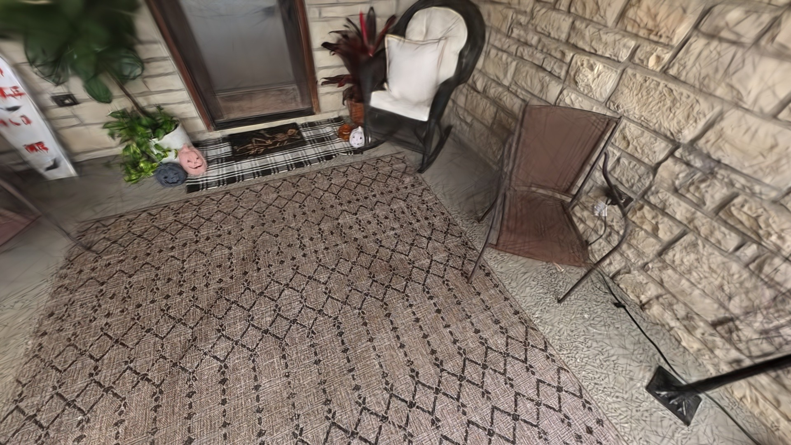
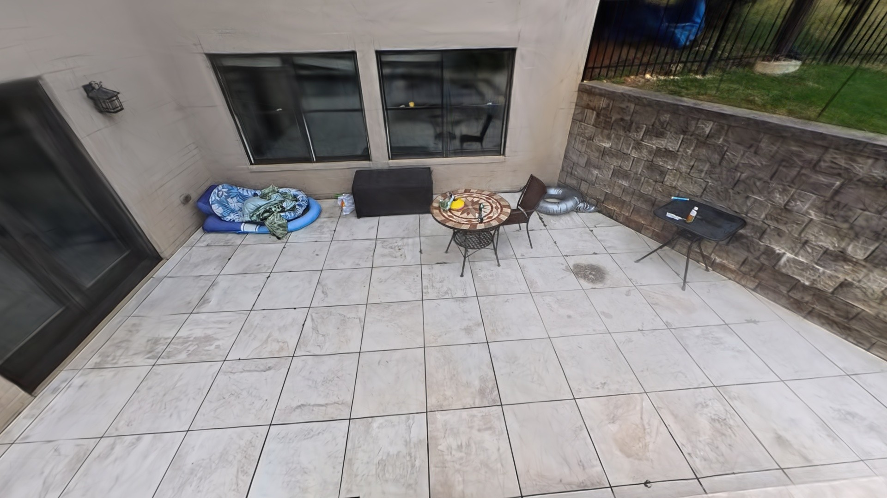
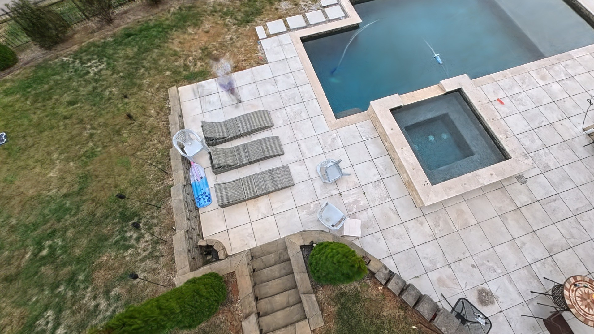

# insv-splat

**Stitch-free Insta360 & Antigravity A1 (`.insv`) dual-fisheye video to 3D Gaussian Splatting pipeline** — featuring pure-Python factory **Mei Unified Omnidirectional (`offset_v3` / Lens Type `155`)** calibration parsing, analytical **zero-baseline spherical `pycolmap.RigConfig` + GLOMAP** Structure-from-Motion, **Brush (Vulkan)** GPU training, and a **server-side PyTorch CUDA + Triton (`sm_120`) WebSocket LAN viewer** capable of streaming 8M+ SH3 Gaussians to any phone, tablet, or laptop browser.

<p align="center">
  
  
  
</p>

---

## Why `insv-splat` Exists

Most `.insv`-to-3DGS scripts wrap the closed-source **Insta360 MediaSDK** to stitch dual-fisheye streams into equirectangular `360°` panoramas before slicing perspective crops. That workflow breaks down in two critical ways on 360° drones (such as the **Antigravity A1**) and close-range captures:

1. **Zero Proprietary SDK Dependency (Native Lens Type `155` Support):**
   Public builds of the Insta360 MediaSDK reject newer `offset_v3` Lens Type `155` trailers (`offset is not support`). `insv-splat` parses the binary EOF trailer (`8db42d694ccc418790edff439fe026bf`) directly in Python and unprojects factory **Mei Unified Omnidirectional** intrinsics (`xi, fx, fy, cx, cy, k1, k2, k3, p1, p2`) from raw `3840×3840` HEVC fisheye streams.
2. **Stitch-Free Zero-Baseline Analytical Spherical Rig:**
   Dual-fisheye cameras separate Lens 0 and Lens 1 by ~`71 mm` across the chassis. Equirectangular stitching across that baseline introduces seam parallax and ghosting on nearby geometry, while double-resampling degrades sharpness. `insv-splat` unprojects a **7-camera `1600×1600` Lanczos4 (`4:4:4` JPEG98) virtual pinhole rig** directly from Lens 0's exact optical center (`cam_from_rig` pure `SO(3)` rotation, `[0, 0, 0]` baseline) plus **4 upright sky-gated Lens 1 upper views**, solves globally in **GLOMAP**, and prunes weak/outlier frames before Ceres bundle adjustment.
3. **Drone-Aware Keyframing & Thin-Client 8M-Splat Streaming:**
   - Hardware-accelerated CUDA NVDEC (`0.5s`) I-frame probing automatically skips stationary hover segments and rejects yaw-jerk motion blur using a local sliding-median Laplacian filter.
   - `insv-splat serve` runs a custom **PyTorch CUDA + Triton (`sm_120` Blackwell-ready) StopThePop 8×8 tile rasterizer** on your workstation GPU/eGPU and streams interactive 3DGS frames over WebSockets to any browser on your LAN or Tailscale network—bypassing mobile/laptop WebGL memory limits.

---

## Architecture


---

## Benchmark: Baseline Crop Pipeline vs. `insv-splat --preset ultra`

Measured on a dual-stream `3840×3840` @ `29.97 fps` **Antigravity A1** residential aerial/close-up capture (`~9m 10s` active flight) trained on an **NVIDIA GeForce RTX 5060 Ti (16 GB eGPU)**:

| Stage / Metric | Baseline (`--preset fast`, 5-View Unbound) | Ultra (`--preset ultra`, Spherical Rig + Upper Views) | Gain |
| :--- | :--- | :--- | :--- |
| **Motion-Spaced Keyframes** | `96` (`2.0s` probe interval) | **`190`** (`0.5s` probe interval + local blur filter) | **`1.98×` temporal density** |
| **Extracted Pinhole Views** | `480` @ `1024×1024` bilinear (`5` Stream 0 views/kf) | **`2,034` @ `1600×1600` Lanczos4 JPEG98 4:4:4** (`7` Stream 0 rig + `4` upright Stream 1 views) | **`10.35×` raw pixel data** |
| **Verified Registered Views** | `313` non-empty (`40` zero-point GLOMAP outliers) | **`1,852` verified inliers** (`91.1%` registration; `132` weak views pruned) | **`5.92×` valid views**, zero sky streaks |
| **Sparse 3D Tie Points** | `25,950` | **`168,452`** | **`6.49×` denser** sparse cloud |
| **Angular Reprojection Error** | `0.581 px` @ `1024 px` (`0.050°`) | **`0.754 px` @ `1600 px` (`0.042°`)** | **`17%` tighter** angular accuracy |
| **Trained 3DGS Model** | `20,000` steps → `3.45M` Gaussians (`775 MB`) | **`40,000` steps → `8.00M` Gaussians (`1.80 GB`)** (`15.8 / 16.3 GiB` VRAM, `25.39 dB` P90 eval PSNR) | **`2.32×` Gaussian capacity** |

---

## Installation

### Prerequisites
- **Linux (`x86_64`)** with an **NVIDIA GPU / eGPU** (Vulkan + CUDA drivers installed)
- **`ffmpeg` / `ffprobe`** with NVDEC (`cuda`) support on `PATH`
- **[`uv`](https://docs.astral.sh/uv/)** (Python 3.11+ package manager)

```bash
git clone https://github.com/tyronechrisharris/insv-splat.git
cd insv-splat

# 1. Install Python environment (PyTorch CUDA, Triton, pycolmap/GLOMAP, OpenCV, FastAPI)
uv sync

# 2. Download standalone Brush v0.3.0 Vulkan 3DGS trainer into ./bin/brush_app
chmod +x scripts/download_brush.sh
./scripts/download_brush.sh
```

---

## Quickstart & CLI Reference

### 1. Inspect `.insv` Calibration & GPU Status
Automatically mounts removable SD/MMC media (via `udisksctl` on Linux) or inspects an explicit `.insv` file:

```bash
uv run insv-splat inspect --input /path/to/VID_20261031_001.insv --anonymize
```

### 2. Reconstruct & Train 3D Gaussian Splats
Run the full 5-stage pipeline (`--preset ultra` is the default; use `--preset balanced` or `--preset fast` for quicker turnarounds, and `--start-time` / `--end-time` to trim pre-flight ground hovers):

```bash
# Full Ultra-Quality 8M-Gaussian reconstruction (16 GB VRAM recommended)
uv run insv-splat run \
  --preset ultra \
  --input /path/to/VID_20261031_001.insv \
  --start-time 15.0 \
  --anonymize

# Faster 20k-step preview run (~8 GB VRAM)
uv run insv-splat run --preset fast --input /path/to/VID_20261031_001.insv
```

Outputs are written to `./runs/<video_stem>/`:
- `exports/splat_final.ply` — Standard 3DGS `.ply` compatible with SuperSplat, PlayCanvas, Blender, Unreal, Unity, and Brush
- `colmap_dataset/sparse/0` — Cleaned, rig-calibrated COLMAP sparse reconstruction
- `pipeline_summary.json` — End-to-end calibration, SfM, PSNR, and GPU telemetry report

### 3. Stream Interactive Server-Side GPU Viewer Over LAN / Tailscale
Render multi-million-Gaussian scenes on your GPU and explore them smoothly from any desktop, tablet, or phone browser on your network (orbit drag, WASD/QE fly mode, altitude-stratified camera presets, FOV/exposure/scale controls, and 1080p HD idle snap):

```bash
uv run insv-splat serve runs/VID_20261031_001 --host 0.0.0.0 --port 8080
```

Or launch the local Vulkan desktop viewer directly:

```bash
uv run insv-splat view runs/VID_20261031_001
```

---

## 360° Drone Capture Guide (Antigravity A1)

Because dual-fisheye lenses capture the **entire 360° sphere simultaneously**, flying for 3DGS is much simpler than flying a gimbal drone:

1. **Never spin/yaw to "look" at subjects:** Smooth translation without stick-yaw eliminates rotational motion blur while both lenses continuously see every angle.
2. **Trim or avoid long ground hovers:** Take off cleanly and keep moving at walking speed; keep yourself indoors or out of sight so moving people don't create ghost splats.
3. **Fly 3 clean altitude tiers (~4–5 minutes total, overcast sky ideal):**
   - **Tier 1 — Eye-Level Detail Loop (`5–8 ft` AGL):** Cruise smoothly past patios, archways, landscaping, and walkways.
   - **Tier 2 — Eave / Roofline Orbit (`20–30 ft` AGL):** Fly one full `360°` perimeter circle `25–35 ft` back from building walls so vertical facades and roof junctions get multi-angle parallax.
   - **Tier 3 — Overhead Lock (`50–70 ft` AGL):** One high circle + `"X"` cross-pass over the site to tie roof planes and ground loops into a rigid global frame.

---

## Running Tests

```bash
uv run pytest
```

## License

Released under the [MIT License](LICENSE).
